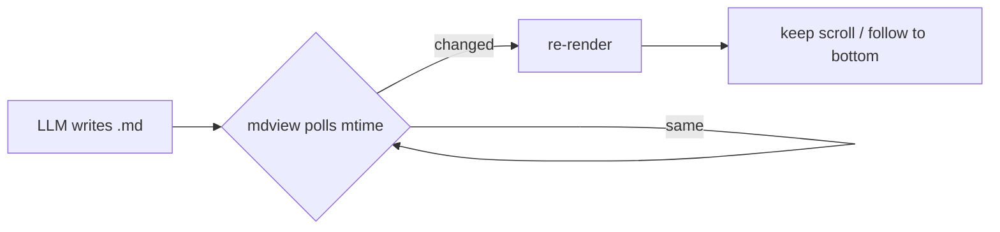
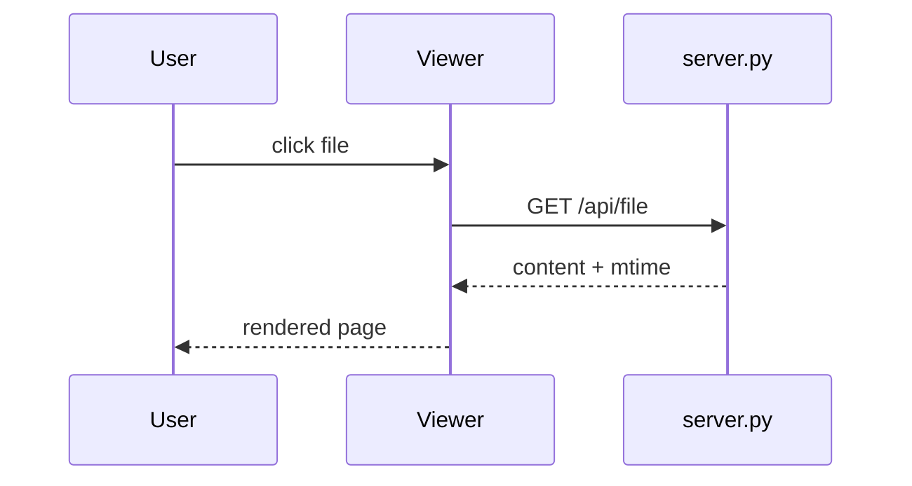

# mdview feature demo

This file exercises everything the renderer supports. Open it next to
[the README](../README.md) to try split panes and in-app links.

## Text

Regular paragraph with **bold**, *italic*, ~~strikethrough~~, `inline code`,
and a [link to GitHub](https://github.com). Autolinks work too: https://example.com.
Press <kbd>Ctrl</kbd>+<kbd>P</kbd> to search files.

> A blockquote with a nested list:
> - one
> - two

> [!NOTE]
> GitHub-style alerts render with a coloured title.

> [!WARNING]
> This one is a warning. It supports **formatting** inside.

> [!TIP]
> Tick *follow* in the status bar and scroll to the bottom while a file is
> being written to watch it grow.

## Lists

1. Ordered item
2. Another
   - nested bullet
   - another nested
     1. deeper ordered

- [x] Done task
- [ ] Open task
- [ ] Another open task

## Code

```python
import asyncio

async def main(n: int = 3) -> None:
    """Count down, then say hello."""
    for i in range(n, 0, -1):
        print(f"{i}...")
        await asyncio.sleep(0.1)
    print("hello, world")

asyncio.run(main())
```

```rust
fn fib(n: u64) -> u64 {
    match n { 0 => 0, 1 => 1, _ => fib(n - 1) + fib(n - 2) }
}
```

```bash
python server.py D:\notes --port 8765
```

A block without a language:

```
plain text stays plain
    with indentation preserved
```

## Math

Inline math like $E = mc^2$ and $\alpha_1 + \beta_2 = \gamma$ works, and so do
prices like $5 and $10 without becoming maths.

$$
\int_{-\infty}^{\infty} e^{-x^2}\,dx = \sqrt{\pi}
$$

$$
\begin{aligned}
\nabla \cdot \mathbf{E} &= \frac{\rho}{\varepsilon_0} \\
\nabla \times \mathbf{B} - \frac{1}{c^2}\frac{\partial \mathbf{E}}{\partial t} &= \mu_0 \mathbf{J}
\end{aligned}
$$

## Diagrams





## Table

| Feature | Status | Notes |
| --- | :---: | ---: |
| Live reload | ✅ | 1 s poll |
| Math | ✅ | KaTeX |
| Mermaid | ✅ | lazy |
| Split panes | ✅ | drag tabs between them |

## Long section for scrolling

### Subsection A

Lorem ipsum dolor sit amet, consectetur adipiscing elit. Sed do eiusmod tempor
incididunt ut labore et dolore magna aliqua. Ut enim ad minim veniam, quis
nostrud exercitation ullamco laboris nisi ut aliquip ex ea commodo consequat.

### Subsection B

Duis aute irure dolor in reprehenderit in voluptate velit esse cillum dolore eu
fugiat nulla pariatur. Excepteur sint occaecat cupidatat non proident, sunt in
culpa qui officia deserunt mollit anim id est laborum.

#### Deeper heading

Some more text so the outline has depth.

<details>
<summary>Collapsible section</summary>

Hidden content with `code` and a list:

- a
- b

</details>

---

The end.
